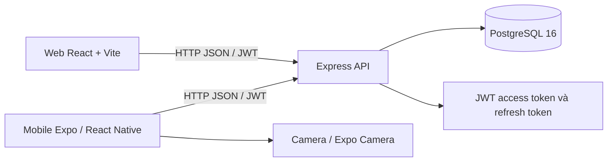

# BÁO CÁO DỰ ÁN NORTHSTAR WMS

**Tên đề tài:** Xây dựng hệ thống quản lý kho Northstar WMS  
**Phiên bản tài liệu:** 1.0  
**Ngày cập nhật:** 21/10/2026  
**Nền tảng:** Ứng dụng web, ứng dụng di động và API dùng chung

> Báo cáo này mô tả những gì đang có trong mã nguồn hiện tại. Các ý tưởng trong tài liệu yêu cầu mở rộng như quản lý nhà cung cấp đầy đủ, báo cáo ABC, nhiều cấp phân quyền tùy chỉnh, thông báo đẩy, v.v. không được xem là đã triển khai nếu không được liệt kê trong phần phạm vi hiện tại.

## 1. Tóm tắt

Northstar WMS là ứng dụng quản lý kho chạy cục bộ, tổ chức theo mô hình monorepo. Hệ thống gồm giao diện quản trị web React/Vite, ứng dụng kho di động Expo/React Native, API Express và cơ sở dữ liệu PostgreSQL. Web và điện thoại gửi yêu cầu đến cùng API, dữ liệu nghiệp vụ được lưu trong cùng cơ sở dữ liệu.

Hệ thống hỗ trợ tra cứu tồn kho, danh mục SKU/mã vạch, ghi nhận nhập kho, tạo và xử lý phiếu xuất, theo dõi giao hàng, sổ giao dịch tồn kho, tài khoản/vai trò và quét mã bằng camera trên điện thoại. Dashboard web tự tải lại dữ liệu định kỳ; ứng dụng chưa dùng WebSocket để đẩy thay đổi tức thời.

## 2. Bối cảnh và mục tiêu

Quản lý kho bằng bảng tính hoặc ghi chép rời rạc gây khó khăn khi theo dõi số lượng thực tế, lô hàng, vị trí lưu trữ và trách nhiệm của nhân viên. Dự án xây dựng một luồng dữ liệu thống nhất để nhân viên thao tác tại kho bằng điện thoại và người quản lý theo dõi/nghiệp vụ bằng web.

### Mục tiêu

- Theo dõi tồn kho theo kho, SKU, vị trí kệ, lô và hạn dùng.
- Ghi nhận nghiệp vụ nhập/xuất và lịch sử biến động tồn.
- Hỗ trợ tạo phiếu xuất, giữ hàng, xác nhận lấy hàng/đóng gói và giao hàng.
- Cho phép tra cứu mã vạch/QR bằng camera điện thoại.
- Áp dụng vai trò tài khoản và giới hạn dữ liệu theo kho được cấp.
- Cung cấp tài liệu chạy và thao tác để người dùng có thể tự cài đặt, trình diễn và phát triển tiếp.

## 3. Phạm vi chức năng hiện tại

### 3.1 Web

- **Tổng quan:** số SKU, số lượng tồn, số lượng đã giữ, đơn đang mở, cảnh báo tồn thấp và biểu đồ biến động mẫu; dữ liệu dashboard được tải lại khoảng 30 giây một lần.
- **Tồn kho:** xem và tìm kiếm số lượng theo SKU/kho/vị trí/lô/hạn sử dụng; có thao tác xuất dữ liệu CSV nếu được cung cấp trên màn hình.
- **Danh mục sản phẩm:** tìm kiếm, thêm, sửa và ẩn sản phẩm/SKU; gồm mã vạch, đơn vị, danh mục và tồn tối thiểu. Quản lý danh mục hiện ở mức tên danh mục trên sản phẩm, chưa phải module phân cấp danh mục riêng.
- **Nhập kho:** chọn kho, sản phẩm, số lượng, lô, hạn dùng và vị trí; xác nhận nhập cập nhật tồn và ghi sổ giao dịch.
- **Xuất kho:** tạo phiếu với mã đơn, người nhận, số điện thoại/địa chỉ người nhận, sản phẩm và số lượng; cấp phát/giữ hàng; xác nhận lấy hàng/đóng gói để trừ tồn.
- **Chứng từ xuất:** sau khi đơn đã đóng gói, in chứng từ hoặc dùng hộp thoại in của trình duyệt để lưu PDF. Chứng từ thể hiện người tạo phiếu (họ tên, email, số điện thoại), người nhận, hàng hóa và QR tra cứu phiếu.
- **Giao hàng:** xem đơn đã đóng gói/đang giao, bắt đầu giao, xác nhận đã giao và làm mới danh sách.
- **Nhật ký kho:** xem các giao dịch nhập, xuất, giữ hàng và điều chỉnh tồn.
- **Tài khoản & phân quyền:** quản trị viên thêm/sửa tài khoản, vai trò, kho truy cập, khóa tài khoản và đặt lại mật khẩu.
- **Tài khoản của tôi:** người dùng xem vai trò/kho được cấp và tự sửa họ tên, email, điện thoại; không tự đổi vai trò hoặc quyền kho.

### 3.2 Ứng dụng di động

- Đăng nhập; token được lưu trong SecureStore.
- Tab **Lấy hàng**: xem đơn và mặt hàng; cấp phát/giữ hàng, xác nhận lấy hàng và đóng gói.
- Tab **Quét mã**: yêu cầu quyền camera; quét mã vạch sản phẩm để tra cứu tồn/vị trí hoặc quét QR phiếu xuất để xem thông tin đơn đã tải.
- Tab **Giao hàng**: xem đơn đủ điều kiện, bắt đầu giao và xác nhận đã giao.
- Có hàng đợi cục bộ cho một số thao tác giao hàng; đây chưa phải chế độ ngoại tuyến đầy đủ cho mọi nghiệp vụ.

### 3.3 Vai trò

| Vai trò | Quyền chính |
|---|---|
| `ADMIN` | Quản trị tài khoản/danh mục, xem dữ liệu toàn hệ thống và thao tác nghiệp vụ quản trị. |
| `WAREHOUSE` | Thao tác nghiệp vụ kho trong các kho được cấp; không quản trị người dùng. |
| `SHIPPER` | Thao tác giao hàng trong phạm vi kho được cấp. |

API kiểm tra vai trò và quyền kho ở các thao tác được bảo vệ. Giao diện ẩn một số mục theo vai trò nhưng kiểm tra quyền cuối cùng nằm ở API.

## 4. Kiến trúc hệ thống



### Công nghệ

| Thành phần | Công nghệ |
|---|---|
| Web | React 18, Vite, React Router, Recharts, Lucide |
| Mobile | React Native, Expo, Expo Camera, SecureStore, AsyncStorage |
| API | Node.js, Express, Zod, JWT, bcryptjs |
| Cơ sở dữ liệu | PostgreSQL 16; Docker Compose phục vụ phát triển cục bộ |
| Workspace | npm workspaces trong monorepo |

### Cấu trúc mã nguồn

```text
apps/
  api/       API Express, schema, migrate và seed dữ liệu mẫu
  web/       Giao diện quản trị React/Vite
  mobile/    Ứng dụng kho Expo
packages/
  shared/    Hàm dịch và định dạng dùng chung
scripts/     Script khởi chạy API và Expo trong môi trường phát triển
docker-compose.yml
```

## 5. Thiết kế dữ liệu

Các nhóm bảng chính trong PostgreSQL:

- **Tài khoản và phân quyền:** `users`, `user_warehouses`, `refresh_tokens`.
- **Kho và vị trí:** `warehouses`, `zones`, `bins`.
- **Danh mục:** `categories`, `products`, `variants`.
- **Tồn:** `inventory_levels` (số lượng thực tế, đã giữ, khả dụng, lô/hạn dùng/vị trí).
- **Nhập:** `purchase_orders`, `po_items`, `goods_receipts`, `grn_items`.
- **Xuất và giao:** `sales_orders`, `so_items`, `reservations`, `reservation_items`, `pick_lists`, `pack_lists`, `shipments`.
- **Kiểm kê và lịch sử:** `stocktakes`, `stocktake_items`, `inventory_adjustments`, `inventory_transactions`.

Mỗi lần biến động tồn được ghi vào `inventory_transactions`. Cơ sở dữ liệu tạo trigger ngăn sửa/xóa trực tiếp sổ giao dịch. API dùng giao dịch PostgreSQL cho các bước cập nhật tồn quan trọng; cấp phát ưu tiên lô hết hạn trước (FEFO).

## 6. Luồng nghiệp vụ tiêu biểu

### Nhập kho

1. Mở **Nhập kho**, chọn kho, SKU, số lượng nhận, mã lô, hạn dùng và ô/kệ.
2. Chọn **Xác nhận đã nhận**.
3. API cập nhật `inventory_levels`, thêm dòng `goods_receipts`/`grn_items` và ghi giao dịch loại `RECEIPT`.
4. Làm mới **Tồn kho** hoặc dashboard để kiểm tra.

### Xuất kho

1. Mở **Xuất kho → Tạo phiếu xuất**, nhập mã đơn, thông tin người nhận và mặt hàng.
2. Chọn **Tạo đơn xuất** để lưu phiếu trạng thái mở.
3. Chọn **Cấp phát** để giữ tồn khả dụng; hệ thống phân bổ theo FEFO.
4. Chọn **Xác nhận lấy hàng / xuất** để trừ tồn và ghi giao dịch xuất.
5. Dùng **In phiếu xuất / PDF** để in hoặc lưu PDF. QR trên chứng từ chứa định danh phiếu để ứng dụng di động tra cứu.

### Giao hàng

1. Đơn đã đóng gói sẽ xuất hiện ở **Giao hàng** và tab **Deliver**.
2. Chọn **Bắt đầu giao**, sau đó **Xác nhận đã giao**.
3. Web/điện thoại cùng đọc trạng thái phiếu từ API và cơ sở dữ liệu.

## 7. Đồng bộ dữ liệu và giới hạn

Web và điện thoại **dùng chung API và PostgreSQL**, vì vậy nghiệp vụ đã ghi thành công lên máy chủ sẽ được nền tảng kia thấy khi tải lại dữ liệu. Dashboard web tự làm mới theo chu kỳ; mobile tải lại sau đăng nhập/thao tác hoặc khi bấm đồng bộ. Không có WebSocket/push để đảm bảo mọi thay đổi hiện lên tức thời trong cùng một giây.

Một số thao tác giao hàng có thể được lưu hàng đợi trên thiết bị khi mất mạng và thử gửi lại khi đồng bộ. Không nên xem ứng dụng hiện tại như một giải pháp offline hoàn chỉnh: không phải mọi thao tác nhập/xuất/kiểm kê đều được ghi offline rồi phát lại an toàn.

## 8. Cài đặt và chạy

Yêu cầu và các lệnh chạy chi tiết nằm trong [HUONG_DAN_SU_DUNG.md](HUONG_DAN_SU_DUNG.md). Tóm tắt:

```bash
npm start
```

Lệnh khởi tạo môi trường, bật PostgreSQL, chạy schema/seed rồi chạy API, web và Expo. Web: `http://localhost:5173`; API health: `http://localhost:4000/api/health`; Metro mặc định: cổng `8081` và hiển thị QR trong terminal.

## 9. Tài khoản trình diễn và an toàn thông tin

Dữ liệu seed cung cấp ba tài khoản mẫu:

| Vai trò | Email | Mật khẩu demo |
|---|---|---|
| Quản trị | `admin@wms.local` | `WmsDemo!2026` |
| Nhân viên kho | `warehouse@wms.local` | `WmsDemo!2026` |
| Nhân viên giao hàng | `shipper@wms.local` | `WmsDemo!2026` |

Đây là thông tin dành riêng cho môi trường demo. Trước khi chia sẻ hoặc triển khai:

- Đổi mật khẩu demo; không dùng tài khoản mẫu ngoài môi trường thử nghiệm.
- Tạo `.env` từ `.env.example`, đặt `JWT_ACCESS_SECRET`, `JWT_REFRESH_SECRET` đủ dài và duy nhất.
- Không commit `.env`, mật khẩu thật, token, thông tin khách hàng hoặc bản sao cơ sở dữ liệu; `.env` đã được ignore trong Git.
- Thay mật khẩu PostgreSQL mặc định trong Docker Compose và cấu hình bảo mật/HTTPS/backup trước khi triển khai thật.

## 10. Kiểm tra và tình trạng hoàn thiện

- Web có lệnh build sản xuất: `npm run build --workspace=@wms/web`.
- API có thể kiểm tra cú pháp bằng `node --check apps/api/src/server.js`.
- Hiện chưa có bộ kiểm thử tự động unit/integration/e2e trong các script npm.
- Chức năng kiểm kê có API tạo đợt, ghi số đếm và duyệt chênh lệch; giao diện đầy đủ cho toàn bộ quy trình chưa phải trọng tâm hiện tại.
- Chưa có quản lý nhà cung cấp/khách hàng chuyên biệt, nhập danh mục từ Excel, báo cáo NXT theo kỳ/ABC, nhiều cấp role tùy chỉnh, thông báo đẩy, upload ảnh chứng từ, WebSocket, MFA hoặc triển khai production.
- Thông tin lô/hạn dùng và dữ liệu vị trí được lưu ở mức cơ bản; các màn hình nâng cao như bản đồ kho, điều phối tuyến nhặt tối ưu, trả hàng/RMA chưa được triển khai đầy đủ.

## 11. Hướng phát triển

1. Bổ sung kiểm thử nghiệp vụ nhập/xuất/giữ hàng/giao hàng và kiểm thử quyền truy cập theo kho.
2. Hoàn thiện quản trị kho, zone/bin, danh mục và hồ sơ nhà cung cấp/khách hàng.
3. Xây báo cáo nhập-xuất-tồn, tuổi tồn, hàng cận hạn và năng suất.
4. Hoàn thiện kiểm kê trên web/mobile cùng quy trình phê duyệt.
5. Bổ sung đồng bộ offline có idempotency cho thao tác kho, đồng bộ nền và trạng thái kết nối chính xác.
6. Tăng cường an toàn triển khai: HTTPS, chính sách mật khẩu, MFA, sao lưu/khôi phục, log và giám sát.

## 12. Tài liệu liên quan

- [Hướng dẫn sử dụng và chạy dự án](HUONG_DAN_SU_DUNG.md)
- [README của repository](README.md)
